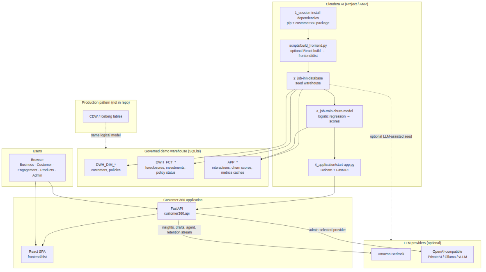
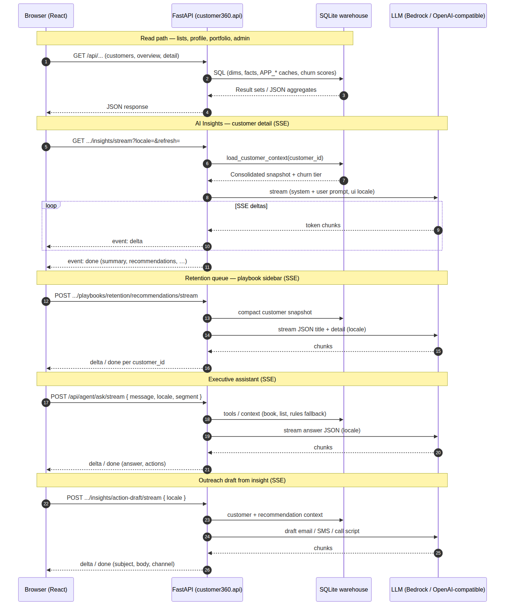

# Cloudera Blueprint: Insurance Customer 360 Dashboard

[](LICENSE)
[](requirements.txt)
[](METADATA.yaml)
[]()
[](https://github.com/cloudera-applied-ai/AI_Blueprint_Insurance-Customer-360/stargazers)
[](https://github.com/cloudera-applied-ai/AI_Blueprint_Insurance-Customer-360/network/members)

> Unified customer dashboard for **Cloudera AI (CAI)**, backed by a **DDS-aligned warehouse**, with churn scoring, synthetic interaction events, and optional **Amazon Bedrock** for AI insights and outreach drafts.

## Table of Contents

- [Overview](#overview)
- [Demo](#demo)
- [Use Case](#use-case)
- [Key Features](#key-features)
- [Quickstart / Guide](#quickstart--guide)
- [Architecture / Software Components](#architecture--software-components)
- [Target Audience](#target-audience)
- [Repository Structure](#repository-structure)
- [Prerequisites](#prerequisites)
- [Hardware Requirements](#hardware-requirements)
- [Documentation](#documentation)
- [Development workflow](#development-workflow)
- [Configuration and localization](#configuration-and-localization)
- [Warehouse domains](#warehouse-domains)
- [Churn intelligence](#churn-intelligence)
- [Local development](#local-development)
- [`__file__` / Workbench interactive runs](#__file__--workbench-interactive-runs)
- [Scale to ~5,000 customers](#scale-to-5000-customers)
- [API performance (large warehouses)](#api-performance-large-warehouses)
- [Frontend without Node on PATH](#frontend-without-node-on-path)
- [Applied AI sentiment reference service](#applied-ai-sentiment-reference-service)
- [Bedrock Playground](#bedrock-playground)
- [License](#license)

## Overview

**Insurance Customer 360** is a launchable **Cloudera AI application (AMP)** that gives agents and advisors a single pane for customer value, policies, investments, foreclosures, churn risk, and AI-generated insights. A FastAPI backend serves a React dashboard from one process; import jobs install dependencies, build the UI, seed a synthetic warehouse, train a churn model, and start the app. The warehouse schema mirrors enterprise DDS naming (`DWH_*` facts and dimensions plus `APP_*` application tables). Optional Bedrock integration powers customer summaries and clickable outreach drafts (email, SMS, call scripts) when AWS credentials are configured.

## Demo

Architecture diagrams and request-flow illustrations show how CAI import stages, SQLite, FastAPI + React, and optional LLM providers fit together.

| Resource                                                               | Description                                                                              |
| ---------------------------------------------------------------------- | ---------------------------------------------------------------------------------------- |
| [Runtime architecture (PNG)](docs/diagrams/runtime-architecture.png)   | CAI AMP import jobs, SQLite warehouse, FastAPI + React, optional LLM providers           |
| [Logical request flows (PNG)](docs/diagrams/logical-request-flows.png) | REST reads and SSE streams for insights, retention queue, assistant, and outreach drafts |
| [Diagram sources & regenerate](docs/diagrams/README.md)                | Mermaid (`.mmd`) sources and `mermaid-cli` commands to refresh PNGs                      |





## Use Case

Insurance distribution and service teams need a **360° customer view** that combines policies, savings, risk signals, and recent interactions without standing up a full data lake for a proof of concept. Compliance and retention workflows also require **explainable churn scores** and **auditable AI assistance** (insights and draft outreach) rather than opaque chat-only tools.

This blueprint delivers a **CAI-hosted dashboard** on realistic synthetic data: seeded warehouse tables, trained churn tiers, interaction events for narrative context, and Bedrock-backed summaries and drafts when configured. The outcome is a demo-ready Customer 360 experience that architects can extend toward Hive, OpDB, or production AMP deployment.

## Key Features

- **DDS-aligned SQLite warehouse** with customers, policies, investments, foreclosures, interaction events, and application caches for fast API reads.
- **AMP import pipeline** — dependency install, React build, database seed, churn training, and application launch via `.project-metadata.yaml`.
- **Churn intelligence** — logistic regression on warehouse behaviour plus interaction aggregates; scores exposed in the UI and API.
- **Amazon Bedrock** (optional) for customer AI insights and generated recommendation drafts; template fallbacks when Bedrock is unavailable.
- **Localization** — multi-region seed profiles (`il`, `gb`, `es`, `sa`, `fr`), seed languages, UI packs (`en`, `fr`, `es`, `he`, `ar`), and admin reseed controls.
- **Prebuilt `frontend/dist/`** so CAI runtimes without Node can still deploy; optional portable Node bootstrap for UI rebuilds.
- **Companion demos** in-repo: Applied AI sentiment reference service and a separate Bedrock chat playground.

## Quickstart / Guide

### Deploy on Cloudera AI

This repo is packaged as a **CAI application (AMP)** via `.project-metadata.yaml` and
`amp-catalog.yaml`. Step-by-step instructions: [docs/CAI_APPLICATION.md](docs/CAI_APPLICATION.md).

1. Create a project from this Git repository and **configure as prototype**, or launch from your
  AMP catalog entry (**Insurance Customer 360**).
2. On first import, `.project-metadata.yaml` runs these stages in order:

  | Stage | Folder / script                   | Purpose                                      |
  | ----- | --------------------------------- | -------------------------------------------- |
  | 1     | `1_session-install-dependencies/` | Python deps + editable `customer360` install |
  | 2     | `scripts/build_frontend.py`       | `npm run build` → `frontend/dist`            |
  | 3     | `2_job-init-database/`            | Seed `data/customer360.db`                   |
  | 4     | `3_job-train-churn-model/`        | Churn model → `APP_CUSTOMER_CHURN_SCORES`    |
  | 5     | `4_application/start-app.py`      | FastAPI + React dashboard                    |

3. Application scripts bind to `127.0.0.1` and use `CDSW_APP_PORT` (Workbench/CML) or `APP_PORT` (AI Inference, default 8080). Do not hard-code ports.

### Local quickstart

```bash
python3 -m pip install -r requirements-dev.txt
python3 -m pip install -e .
python3 scripts/init_db.py
python3 4_application/start-app.py
python3 -m pytest   # optional; integration tests seed a temp warehouse automatically
```

## Architecture / Software Components

The runtime stacks **Cloudera AI** import jobs, a **SQLite** warehouse, **FastAPI** APIs, and a **React** UI. Optional **Amazon Bedrock** calls run from the Python service layer for insights and outreach generation.

See [Demo](#demo) for PNG architecture and request-flow diagrams. Regenerate diagram assets from Mermaid sources under `docs/diagrams/` per [docs/diagrams/README.md](docs/diagrams/README.md).

### Project layout (CAI-compatible)

```
.
├── .project-metadata.yaml          # CAI AMP import + application tasks
├── amp-catalog.yaml                # Optional AMP catalog registration
├── docs/CAI_APPLICATION.md         # Deploy guide
├── 1_session-install-dependencies/ # stage 1: pip install
├── 2_job-init-database/            # stage 3: warehouse seed
├── 3_job-train-churn-model/        # stage 4: churn training
├── 4_application/                  # stage 5: FastAPI app launcher
├── customer360/                    # Shared Python package (seed, DB, churn, API)
├── data/schema.sql                 # Warehouse DDL
├── scripts/build_frontend.py       # stage 2: React build
└── scripts/init_db.py                # Local dev CLI (same as stage 3 job)
```

## Target Audience

- **Solution architects and SEs** — reference Customer 360 wiring on Cloudera AI with AMP import stages and optional Bedrock.
- **Data and ML engineers** — SQLite seed patterns, churn training job, and API cache design scalable toward Hive or OpDB.
- **Insurance product and retention teams** — demo UX for churn tiers, insights, and outreach drafts.
- **Developers extending the blueprint** — monorepo-friendly layout with editable `customer360` package and committed frontend build output.

## Repository Structure

| Path | Description |
| --- | --- |
| `.project-metadata.yaml` / `amp-catalog.yaml` | CAI AMP prototype definition and catalog registration |
| `customer360/` | Seed, DB access, churn training, FastAPI routers |
| `frontend/` | React UI sources; `frontend/dist/` is the committed production build |
| `data/schema.sql` | Warehouse DDL |
| `docs/CAI_APPLICATION.md` | Deploy and environment guide |
| `docs/diagrams/` | Architecture PNGs and Mermaid sources |
| `scripts/` | `init_db.py`, `scale_warehouse.py`, `refresh_api_caches.py`, `build_frontend.py` |
| `app/` | Applied AI sentiment reference service (separate FastAPI demo) |
| `bedrock-playground/` | Standalone Bedrock chat playground (React + FastAPI) |
| `METADATA.yaml` | Cloudera blueprint catalog metadata |

## Prerequisites

**Cloudera platform**

- Cloudera AI Workbench (or compatible CAI runtime) with project import and Application support.
- Network access for optional Bedrock and for portable Node download during UI rebuilds (`nodejs.org`).

**External services**

- **Amazon Bedrock** (optional) — AWS credentials or instance profile; see `.env.example` and `CUSTOMER360_BEDROCK_*` variables in `.project-metadata.yaml`.

**Tooling**

- Python **3.11+** (see `pyproject.toml`).
- `git`.
- `requirements.txt` / `requirements-dev.txt` for Python dependencies.
- **Node 18+** only when modifying the Customer 360 React UI (see [Frontend without Node on PATH](#frontend-without-node-on-path)).

## Hardware Requirements

| Deployment | Minimum |
| --- | --- |
| Launchable / demo (default ~2,000 customers) | 2 vCPU, 8 GB RAM, ~5 GB storage for SQLite, churn model artifacts, and the CAI Application session |
| Larger warehouse (~5,000 customers) | Additional storage for `data/customer360.db`; run `scripts/scale_warehouse.py` or `CUSTOMER360_SEED_CUSTOMERS` (see [Scale to ~5,000 customers](#scale-to-5000-customers)) |
| Production / enterprise | Size per concurrent users and move warehouse to managed storage (Hive / OpDB); Bedrock and AMP sizing per org standards |

## Documentation

- [CAI application deploy guide](docs/CAI_APPLICATION.md)
- [Architecture diagram sources](docs/diagrams/README.md)
- [Bedrock Playground](bedrock-playground/README.md)
- [Cloudera Machine Learning / CAI documentation](https://docs.cloudera.com/machine-learning/cloud/index.html)

## Development workflow

Use feature branches off `main`, run tests before pushing, and open pull requests
back to `main`.

```bash
git fetch origin
git checkout main && git pull origin main
git checkout -b cursor/your-feature-7a3d
python3 -m pip install -r requirements-dev.txt
python3 -m pip install -e .
python3 -m pytest
# … edit …
git add -A && git commit -m "Describe the change"
git push -u origin cursor/your-feature-7a3d
```

The repo ships a prebuilt `frontend/dist/`; run `npm run build` in `frontend/` only
when you change the UI.

## Configuration and localization

Optional environment variables:

| Variable                         | Default               | Purpose                                                                                                             |
| -------------------------------- | --------------------- | ------------------------------------------------------------------------------------------------------------------- |
| `CUSTOMER360_DB_PATH`            | `data/customer360.db` | Bootstrap SQLite path for admin settings (set to your warehouse file in CAI, e.g. `/home/cdsw/data/customer360.db`) |
| `CUSTOMER360_SEED_TERRITORY`     | `il`                  | Demo **region** for seed data: `il`, `gb`, `es`, `sa`, `fr` (names, cities, currency)                               |
| `CUSTOMER360_SEED_LANGUAGE`      | (per region)          | **Seed language** for interaction copy: `en`, `fr`, `es`, `he`, `ar` (independent of region)                        |
| `CUSTOMER360_SEED_CUSTOMERS`     | `2000`                | Customer count when seeding (see scale docs)                                                                        |
| `AWS_*`, `CUSTOMER360_BEDROCK_*` | —                     | Amazon Bedrock (insights + outreach drafts); see `.env.example`                                                     |

**Region** profiles drive warehouse geography (customer names, cities, employers, currency) and
LLM market context. **Seed language** controls interaction event text and is stored separately
(`APP_TERRITORY_CONFIG.SEED_LANGUAGE`). UI languages are `en`, `fr`, `es`, `he`, and `ar`
(Hebrew is not the same as the Israel region id `il`).

After editing `frontend/src/locales/en.json`, regenerate non-English packs and rebuild the UI:

```bash
python3 -m pip install deep-translator   # or requirements-dev.txt
cd frontend && python3 scripts/build-language-packs.py
npm run build   # updates frontend/dist bundled with Vite
```

Use `{lang}-patch.json` to fix machine-translation glitches (tab labels, product names).
Set `CUSTOMER360_I18N_SKIP_TRANSLATE=1` only for offline smoke tests (overlay-only packs).

**Admin → Configuration → Localization and Territory** persists UI region override and preferred
UI language in `APP_ADMIN_LOCALIZATION` (without reseeding). Use **Reseed warehouse** in that
panel or `POST /api/admin/warehouse/reseed` to rebuild data for a new region + seed language.

Reseed examples:

```bash
CUSTOMER360_SEED_TERRITORY=il CUSTOMER360_SEED_LANGUAGE=en python3 scripts/init_db.py
# or
python3 -m customer360.seed --territory sa --language ar --customers 500
```

**LLM seed material:** When an LLM provider is configured, `init_database` / reseed calls the model
with representative samples for the selected **region** and **seed language**, validates the JSON,
writes customers and interaction copy from that bundle, and caches it under
`data/seed_cache/{region}_{language}.json`. Use `CUSTOMER360_SEED_SKIP_LLM=1` for offline/tests,
`CUSTOMER360_SEED_LLM_REFRESH=1` to bypass cache, and `CUSTOMER360_SEED_REQUIRE_LLM=1` to fail if
generation is unavailable.

## Warehouse domains

| Table                                                  | Domain                                                   |
| ------------------------------------------------------ | -------------------------------------------------------- |
| `DWH_DIM_CUSTOMERS_UNIQUE`                             | Master customer dimension (MDM / portal)                 |
| `DWH_DIM_ALL_POLICY`                                   | Life, health, elementary, pension, and gemel policies    |
| `DWH_FCT_FORECLOSURES` / `DWH_FCT_FORECLOSURES_ASSETS` | Legal encumbrances and linked assets                     |
| `DWH_FCT_POLICY_INVESTMENT_TRACK`                      | Monthly per-policy accumulation by track                 |
| `DWH_FCT_INVESTMENT_TRACK`                             | Regulatory market track performance                      |
| `DWH_FCT_POLICY_STATUS`                                | Policy status, coverage, and surrender/savings snapshots |
| `APP_CUSTOMER_CHURN_SCORES`                            | Churn probability and risk tier per customer ID          |
| `APP_CUSTOMER_INTERACTION_EVENTS`                      | Synthetic reviews, agent questions, and web searches     |
| `APP_CUSTOMER_AI_INSIGHTS`                             | Cached Bedrock (or fallback) customer summaries          |

## Churn intelligence

Features are built from warehouse behaviour plus **interaction events** (reviews, agent
questions, product/help searches), normalized with `StandardScaler`, and modeled with
balanced logistic regression. Scores are stored in SQLite for the API and UI. Interaction
aggregates also feed **Amazon Bedrock** insight prompts when configured. Clickable
recommendation drafts (email, SMS, call scripts) are **Bedrock-generated** as well — templates
are not used when Bedrock is available.

```bash
python 3_job-train-churn-model/train_churn.py
```

## Local development

Same commands as [Local quickstart](#local-quickstart) under **Quickstart / Guide**. Generated databases are gitignored (`data/*.db`).

## `__file__` / Workbench interactive runs

`Path(__file__)` is only defined when Python executes a **file** (for example
`python 2_job-init-database/init_database.py`). In an interactive Workbench cell,
pasting lines that use `__file__` raises `NameError`.

Use one of these instead:

```python
# From a session whose working directory is the project root:
%run 2_job-init-database/init_database.py
%run 3_job-train-churn-model/train_churn.py   # after database init
```

```python
import importlib.util
from pathlib import Path

for candidate in (Path.cwd(), *Path.cwd().parents):
    boot = candidate / "bootstrap_entry.py"
    if boot.is_file():
        spec = importlib.util.spec_from_file_location("bootstrap_entry", boot)
        mod = importlib.util.module_from_spec(spec)
        spec.loader.exec_module(mod)
        mod.bootstrap(None)
        break

from customer360.paths import default_db_path
from customer360.seed import init_database

init_database(default_db_path(), rebuild=True)
```

On Cloudera AI, `CDSW_PROJECT` is set automatically. If the Git repo lives in a
subfolder (e.g. `midgalpoc/`), bootstrap walks that folder too — you do **not** need
to point `CDSW_PROJECT` at the subfolder, but `%cd midgalpoc` before `%run` is fine.

If install fails with a missing `requirements.txt`, run:

```python
%cd midgalpoc   # folder that contains data/schema.sql
%run 1_session-install-dependencies/install.py
```

## Scale to 5,000 customers

The seed generator uses the same DDS-aligned patterns as the default warehouse (policies,
investments, coverage snapshots, foreclosures, interactions) and scales every table from
that logic:

```bash
python3 scripts/scale_warehouse.py --customers 5000
```

Or set `CUSTOMER360_SEED_CUSTOMERS=5000` before the init job / `python3 -m customer360.seed --customers 5000`, then run `3_job-train-churn-model/train_churn.py` for churn scores.

## API performance (large warehouses)

After seeding, the warehouse precomputes:

- `APP_CUSTOMER_METRICS` — per-customer value, policy count, investment tracks (customer list avoids heavy per-row subqueries).
- `APP_OVERVIEW_COUNTS` — domain card counts.
- `APP_PORTFOLIO_ANALYTICS_CACHE` — portfolio charts/KPIs per segment (seed, churn train, or `scripts/refresh_api_caches.py`). The API serves this JSON on read; cache misses are computed once and stored (write-through).
- `APP_BOOK_*_TREND` — materialized book-wide strategic objective series (savings AUM, premium momentum, engagement) for fast chart loads without re-aggregating facts on every request.

Refresh caches on an existing DB without reseeding:

```bash
python3 scripts/refresh_api_caches.py
```

The customer list API enforces `limit` **≤ 100**; the UI defaults to 50 with 25/50/100 options.

## Frontend without Node on PATH

The repo includes a prebuilt `frontend/dist/`. Restart the application after `git pull` —
you do **not** need `npm` for that.

To rebuild the UI in a standard Python 3.11 CAI session (no system Node):

```python
%run scripts/build_frontend.py
```

The script skips work if `frontend/dist/index.html` already exists. It downloads a
portable Node.js binary into `.tools/` when `npm` is missing (requires outbound HTTPS
to `nodejs.org`).

## Applied AI sentiment reference service

A minimal, self-contained **Applied AI** demo (TF-IDF + logistic regression via
scikit-learn) served through **FastAPI** with a small static web UI. It lives
alongside Customer 360 in this repo and uses its own dependencies
(`applied-ai-sentiment-requirements.txt`).

```
app/              FastAPI app + model training/inference
scripts/train.py  Trains models/sentiment.joblib
static/index.html Demo UI
tests/            pytest unit + API tests
.cursor/          Optional Cloud Agent install/start helpers for this demo
```

```bash
bash .cursor/install.sh   # train model + venv deps for sentiment demo
bash .cursor/start.sh     # http://localhost:8000
```

Manual run: `pip install -r applied-ai-sentiment-requirements.txt`, then
`python -m scripts.train` and `uvicorn app.main:app --host 0.0.0.0 --port 8000`.

## Bedrock Playground

A separate **AWS Bedrock chat playground** (React + FastAPI) lives under
[`bedrock-playground/`](bedrock-playground/README.md). It does not share the
Customer 360 `frontend/` tree.

```bash
cd bedrock-playground
cp backend/.env.example backend/.env   # optional AWS credentials
python start.py
```

See [bedrock-playground/README.md](bedrock-playground/README.md) for architecture,
CML/CDSW port notes, and security guidance.

## License

This project is licensed under the [Apache License 2.0](LICENSE).
